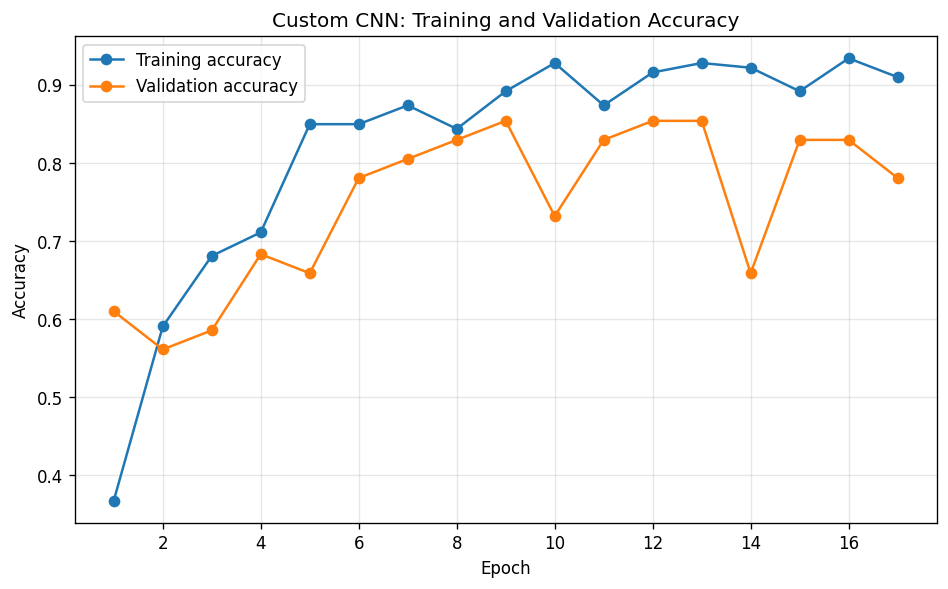
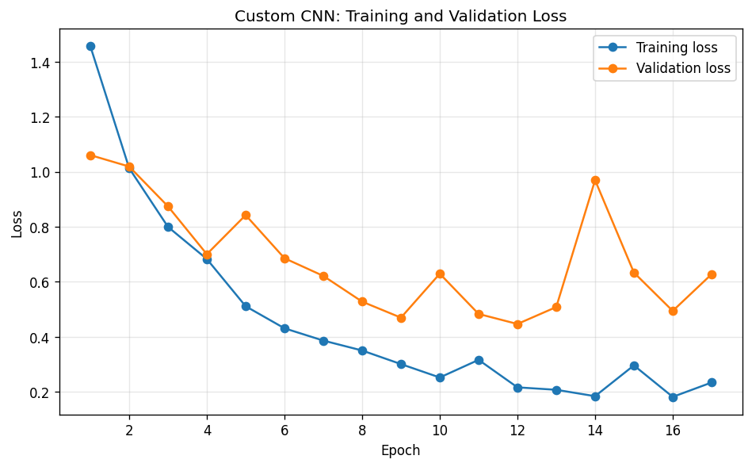
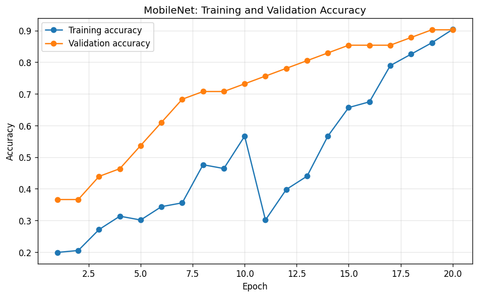
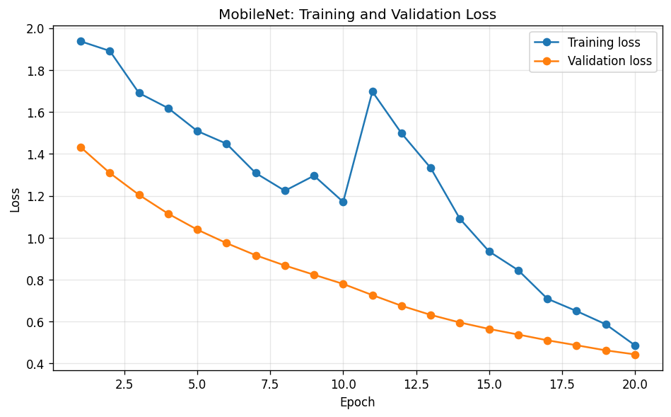

# Lightweight Image Classification for Museum Artifact Recognition on Raspberry Pi 5: Custom CNN vs. MobileNetV2 with TFLite Quantisation

Zihao Zhou

## Abstract
Group tours cannot match the different interests of every museum visitor, and a device that recognises an artifact on the spot could give each visitor their own guide. This study asks whether a lightweight image classifier, trained on a small custom museum dataset, can run on a Raspberry Pi 5 fast enough for real-time recognition, and how a custom convolutional neural network (CNN) compares with MobileNetV2. I photographed five artifacts at Suzhou Museum West (207 images in total), trained both models with data augmentation and early stopping, converted them to TensorFlow Lite (TFLite) with float16 quantisation, and measured validation accuracy, file size and inference time on a Mac and on a Raspberry Pi 5. On the 41-image validation set, MobileNetV2 reached 90.24% accuracy (37/41) and the custom CNN 85.37% (35/41). Conversion to TFLite fp16 did not change any prediction for either model, while it reduced the model files from 37.8 MB to 6.3 MB (CNN) and from 23.5 MB to 4.3 MB (MobileNetV2). On the Raspberry Pi 5, the CNN needed 6.79 ms per image and MobileNetV2 11.65 ms, about 147 and 86 images per second, both far faster than a typical 30 frames-per-second camera. Both models are therefore feasible on the Pi; MobileNetV2 gives the better balance of accuracy and size, while the custom CNN is faster. Because the validation set is small, the two-image accuracy gap should be read as indicative rather than conclusive.

## 1 Introduction
Many museums still guide visitors in groups. A group tour follows one route at one pace, but different visitors are interested in different artifacts, and a single guide cannot answer everyone's questions at the same time. A personal device that recognises the artifact a visitor is looking at, and then shows information about it, could give every visitor a tour of their own.

Image classification with deep learning can recognise objects from photos, but such models are usually trained and run on powerful computers or in the cloud. A museum guide device needs to be small, cheap and able to work without a network connection, so the model has to run on an embedded system with limited memory and computing power. This makes model size and inference speed as important as accuracy.

This paper asks: **Can a lightweight image classification model, trained on a custom museum dataset, be deployed on a Raspberry Pi for real-time artifact recognition, and how does a custom CNN perform compared to MobileNetV2 in accuracy, size, and inference speed?**

To answer this, I photographed five artifacts at Suzhou Museum West: a bronze bowl, a crystal cup, a fish fan, a jade figure and a pen container, about 40 images each. I trained a custom CNN and a MobileNetV2 model on this dataset, converted both to TFLite with float16 quantisation, checked that the conversion did not change their predictions, and deployed both on a Raspberry Pi 5 to measure inference time. The contributions of this paper are:
1. a small five-class museum artifact dataset collected for this study;
2. a side-by-side comparison of a custom CNN and MobileNetV2 in accuracy, file size and inference time, before and after TFLite fp16 conversion;
3. measured inference times on a real Raspberry Pi 5, showing that both models are fast enough for real-time use.

## 2 Background
Ray (2022) reviews TinyML, the field of running machine learning models directly on resource-constrained embedded devices and microcontrollers. The review surveys hardware platforms, software frameworks such as TensorFlow Lite, model compression techniques such as quantisation, pruning and knowledge distillation, and application domains. This gives the context for this paper: quantisation is one of the key compression methods discussed in the review, and TensorFlow Lite is one of the main frameworks for deploying models on small devices. However, the review does not cover museum applications, which is the direction of this paper.

I chose MobileNetV2 as the comparison model because it is a widely used architecture designed for mobile and embedded devices. Sandler et al. (2018) built MobileNetV2 around inverted residual blocks with linear bottlenecks and depthwise separable convolutions, which keep classification accuracy high while greatly reducing the number of parameters and computations. Because it is pre-trained on the large ImageNet dataset (Deng et al., 2009), it can also be adapted to a new task with few images through transfer learning. This makes it a strong baseline for a small custom CNN. Sandler et al. (2018) reported results on ImageNet and measured speed on a mobile phone, but not on a single-board computer such as the Raspberry Pi; this paper measures it there.

Bermeitinger et al. (2016) used a CNN to classify objects in images of neoclassical artifacts, the same kind of task as in this paper, and dealt with the problems of having few images and artifacts that are difficult to label. Their work shows that artifact recognition is a meaningful image classification problem for cultural heritage research. However, they focused on classification accuracy and on searching art-historical collections, while this paper also considers the trade-off between accuracy and the limited resources of an embedded device.

## 3 Methods

### 3.1 Dataset
The dataset consists of five artifacts that I photographed at Suzhou Museum West in Suzhou, China: a bronze bowl, a crystal cup, a fish fan, a jade figure and a pen container. Each artifact is one class. **[TODO: when the photos were taken, with what device, and how — e.g. different angles/distances, lighting, glass case reflections, how many visits.]** Table 1 shows the number of images per class.

**Table 1. Images per class.**

| Class | Images |
|---|---:|
| Bronze bowl | 44 |
| Crystal cup | 39 |
| Fish fan | 39 |
| Jade figure | 39 |
| Pen container | 46 |
| **Total** | **207** |

In my first two experiment runs, the fish fan class had only 19 images, all of the front side, which made the classes unbalanced. For the final run, I added 20 photos of the back side of the fan. The back has a different pattern, but it is still the same object, so I kept both sides in one class. All results in this paper come from this final dataset.

The images were split into 80% training (166 images) and 20% validation (41 images) using Keras' `image_dataset_from_directory` with a fixed random seed (123), so both models were trained and evaluated on exactly the same split. The original photos have different resolutions (from 640×480 up to 4608×2592 pixels); each image was resized to 180×180 pixels for the CNN and 160×160 pixels for MobileNetV2, because MobileNetV2's pre-trained weights are provided for a fixed set of input sizes (including 160×160).

### 3.2 Model Architectures
**Custom CNN.** The custom CNN follows the image classification tutorial from TensorFlow. After data augmentation (Section 3.3), a Rescaling layer maps pixel values from [0, 255] to [0, 1]. The network then has three blocks of a Conv2D layer (16, 32 and 64 filters, 3×3, ReLU) followed by a MaxPooling2D layer. The Conv2D layers extract features such as edges, patterns and shapes, and the MaxPooling2D layers halve the size of the feature maps while keeping the strongest responses. A Flatten layer turns the final 20×20×64 feature maps into a vector of 25,600 values, which goes into a Dense layer with 128 neurons that combines the features. The output Dense layer has 5 neurons, one per class; softmax is applied to its outputs to give a probability for each class. The CNN has about 3.30 million parameters, and 99% of them are in the first Dense layer, because every one of the 25,600 flattened values is connected to all 128 neurons.

**MobileNetV2.** I used MobileNetV2 pre-trained on ImageNet without its original 1,000-class output layer. A Rescaling layer maps pixels to [-1, 1], the range MobileNetV2 was trained with. After the base model, a GlobalAveragePooling2D layer averages each of the 1,280 feature maps into one number, a Dropout layer (rate 0.2) reduces overfitting, and a Dense layer with 5 neurons gives the class scores. The model has about 2.26 million parameters. Training happens in two phases. In Phase 1, the whole pre-trained base is frozen and only the new classification head is trained. In Phase 2, the layers of the base from layer 100 onward are unfrozen and fine-tuned together with the head, so that the higher-level features can adapt to the museum artifacts.

### 3.3 Training Procedure
With only 166 training images, both models could easily memorise the training set. To reduce this, both models use the same data augmentation layers: random horizontal flip, random rotation (up to ±36°, i.e. 10% of a full turn), random zoom, random contrast and random brightness changes. These layers create a slightly different version of each image every epoch, so the model sees more variety and is less likely to memorise the training images. Augmentation is only active during training and is switched off at validation and inference.

Both models use the sparse categorical cross-entropy loss, which measures how far the predicted class probabilities are from the true class, and the Adam optimiser (Kingma & Ba, 2015), which adjusts the learning rate of each parameter adaptively and is widely used for training deep neural networks. The batch size is 32.

Because the dataset is small, the validation loss can start to rise after some epochs while the training loss keeps falling, which means the model is overfitting. To prevent this, I used early stopping: if the validation loss does not improve for 5 consecutive epochs, training stops and the weights from the epoch with the lowest validation loss are restored. The CNN was allowed up to 50 epochs with a learning rate of 1e-3 (the Adam default).

For MobileNetV2, Phase 1 runs for 10 epochs with a learning rate of 1e-4, and Phase 2 runs for another 10 epochs (epochs 11–20) with a learning rate of 1e-5, with early stopping applied separately in each phase. The learning rate in Phase 2 is ten times lower because the unfrozen layers already contain useful features learned from ImageNet; a large learning rate could quickly destroy them, while a small one only adjusts them slightly.

### 3.4 TFLite Conversion
After training, both models are saved as Keras files of 37.8 MB (CNN) and 23.5 MB (MobileNetV2). To run them on an embedded system, I converted both to the TensorFlow Lite format with post-training float16 quantisation (TensorFlow, n.d.). The Keras models store each weight as a 32-bit floating-point number; float16 quantisation stores each weight as a 16-bit floating-point number instead. All layers and weights are kept, only their numerical precision is reduced, which halves the storage needed for the weights. The input of each converted model was fixed to a batch of one image (1×180×180×3 for the CNN, 1×160×160×3 for MobileNetV2), since the device classifies one image at a time.

### 3.5 Deployment on Raspberry Pi
The converted models were deployed on a Raspberry Pi 5 (quad-core Arm Cortex-A76 processor at 2.4 GHz; Raspberry Pi Ltd, 2023) with **[TODO: 4 GB / 8 GB]** of RAM, running **[TODO: Raspberry Pi OS version]**. Instead of installing the full TensorFlow library, I used `tflite-runtime`, a much smaller package that can only run TFLite models, together with NumPy and Pillow. The default Python 3.13 on the Pi was not compatible with `tflite-runtime`, so I created a separate Python 3.11 environment using **[TODO: pyenv / conda / venv]**.

The deployment script (`pi.py`) loads each model with the TFLite interpreter, opens an image with Pillow, converts it to RGB, resizes it to the model's input size with bilinear interpolation, and passes the raw pixel values (0–255) to the model; rescaling is done inside the model. To measure inference time, the script runs one warm-up inference and then times 100 single-image inferences and reports the mean. The timing covers only the model itself, not loading or resizing the image.

### 3.6 Evaluation Metrics
I compared the models on three metrics.

**Accuracy.** Accuracy is the fraction of validation images that a model classifies correctly. It is measured on the held-out validation set, not on the training set, because validation accuracy shows how a model performs on images it has not been trained on. Both the Keras and the TFLite versions of each model were evaluated on the same 41 validation images, built with the same split settings as in training. This matters: in an earlier run, the evaluation script rebuilt the split with different shuffle settings, so the "validation" set overlapped with the training images and the CNN appeared to reach 100% accuracy. After the split was matched, its accuracy fell to a realistic value. With 41 images, one image corresponds to 2.4 percentage points of accuracy.

**Model file size.** The file size determines how much storage and memory a model needs on the embedded device. It mainly depends on the number of parameters and on how many bits are used to store each one.

**Inference time.** Inference time is the average time a model takes to classify one image, in milliseconds. It decides whether a model can work in real time. A typical camera produces 30 frames per second, so a model needs less than about 33 ms per image to keep up. Inference time was measured on two devices: a Mac **[TODO: confirm model, e.g. MacBook Air M2, 8 GB]** for all four model versions, and the Raspberry Pi 5 for the two TFLite models.

To check that the TFLite conversion did not change the models' behaviour, I also compared the Keras and TFLite versions of each model on the validation set using the agreement rate (the fraction of images for which both versions predict the same class) and the maximum and average absolute difference between their predicted class probabilities.

## 4 Results

### 4.1 Training Behaviour
Figure 1 and Figure 2 show the training and validation curves of the two models.

**Figure 1.** Training and validation accuracy (a) and loss (b) of the custom CNN.

**Figure 2.** Training and validation accuracy (a) and loss (b) of MobileNetV2. Phase 2 (fine-tuning) starts at epoch 11.

**Custom CNN.** The CNN learned quickly: its training accuracy reached about 0.85 by epoch 5 and its training loss fell to about 0.18 by epoch 16. Its validation loss reached its lowest value of 0.447 at epoch 12, with a validation accuracy of 0.854. After that the validation loss did not improve: it jumped to 0.97 at epoch 14 and stayed above 0.447 for the next five epochs, so early stopping ended training after epoch 17 and restored the weights from epoch 12. At epoch 17, the training accuracy was 0.91 but the validation accuracy was 0.78, a clear sign of overfitting.

**MobileNetV2.** In Phase 1, with the base frozen, MobileNetV2 improved slowly: the validation accuracy rose from 0.37 to 0.73 over 10 epochs. When Phase 2 began at epoch 11, the training loss jumped from 1.17 to 1.70 and the training accuracy dropped from 0.57 to 0.30, but the validation loss was not affected. After this, both training and validation accuracy rose steadily, reaching 0.90 at epoch 20. The validation loss decreased in every single epoch, from 1.43 to 0.44, and early stopping never triggered. The training accuracy stayed below or close to the validation accuracy throughout, so MobileNetV2 showed no sign of overfitting. Because the validation loss was still falling when training ended, MobileNetV2 may have been stopped before reaching its best performance.

### 4.2 Model Comparison
Table 2 summarises the four model versions, measured on the Mac.

**Table 2. Accuracy, file size and inference time of all models (Mac, 41 validation images).**

| Model | Validation accuracy | File size | Inference time |
|---|---:|---:|---:|
| Custom CNN (Keras) | 85.37% (35/41) | 37.8 MB | 23.5 ms |
| Custom CNN (TFLite fp16) | 85.37% (35/41) | 6.3 MB | 2.3 ms |
| MobileNetV2 (Keras) | 90.24% (37/41) | 23.5 MB | 29.7 ms |
| MobileNetV2 (TFLite fp16) | 90.24% (37/41) | 4.3 MB | 4.5 ms |

**Accuracy.** MobileNetV2 reached 90.24% validation accuracy and the custom CNN 85.37%. The gap is 4.9 percentage points, which is two images out of 41.

**File size.** After conversion, the CNN file shrank from 37.8 MB to 6.3 MB (6.0 times smaller) and the MobileNetV2 file from 23.5 MB to 4.3 MB (5.5 times smaller). Although the CNN is the "simpler" model, its TFLite file is about 1.5 times larger than MobileNetV2's.

**Inference time on the Mac.** The TFLite versions were much faster than the Keras versions: 2.3 ms instead of 23.5 ms for the CNN, and 4.5 ms instead of 29.7 ms for MobileNetV2. Between the two TFLite models, the CNN was about twice as fast as MobileNetV2.

### 4.3 Effect of TFLite Conversion on Predictions
Table 3 compares the Keras and TFLite versions of each model on the 41 validation images.

**Table 3. Keras vs. TFLite fp16 on the validation set.**

| Model | Prediction agreement | Max probability difference | Average probability difference |
|---|---:|---:|---:|
| Custom CNN | 100% (41/41) | 0.000281 | 0.000023 |
| MobileNetV2 | 100% (41/41) | 0.010798 | 0.001413 |

For both models, the TFLite version predicted the same class as the Keras version for every validation image, so the validation accuracy did not change at all. The predicted probabilities changed only slightly. The changes were larger for MobileNetV2 than for the CNN, but even the largest change (about 0.011, or 1.1 percentage points of probability) was too small to change any prediction.

### 4.4 Inference Time on the Raspberry Pi 5
Table 4 compares the inference time of the TFLite models on the Mac and on the Raspberry Pi 5.

**Table 4. TFLite fp16 inference time on the Mac and the Raspberry Pi 5 (mean of 100 runs after one warm-up).**

| Model | Mac (ms/image) | Raspberry Pi 5 (ms/image) | Pi slowdown | Pi images per second |
|---|---:|---:|---:|---:|
| Custom CNN | 2.3 | 6.79 | 2.95× | ≈147 |
| MobileNetV2 | 4.5 | 11.65 | 2.59× | ≈86 |

Both models ran successfully on the Raspberry Pi 5. They were about 2.6 to 3 times slower than on the Mac, but still fast: the CNN needed 6.79 ms per image and MobileNetV2 11.65 ms. On the Pi, the CNN was about 1.7 times faster than MobileNetV2. Both models classify an image in well under the 33 ms available per frame for a 30 frames-per-second camera.

## 5 Discussion

### 5.1 Answering the Research Question
The results answer the first part of the research question positively: both models, trained on a small custom museum dataset, can be deployed on a Raspberry Pi 5 and classify an image in about 7 to 12 ms, which is fast enough for real-time recognition. For the second part, neither model is better in every way. MobileNetV2 was more accurate (90.24% vs. 85.37%) and smaller (4.3 MB vs. 6.3 MB), while the custom CNN was faster (6.79 ms vs. 11.65 ms on the Pi). Because both models are already far faster than a camera's frame rate, the speed advantage of the CNN matters less in practice than MobileNetV2's higher accuracy and smaller size. MobileNetV2 is therefore the better overall choice for this application.

### 5.2 Why MobileNetV2 Generalised Better
The CNN overfitted: it reached high training accuracy, but its validation loss became unstable after epoch 12 and its final training accuracy was well above its validation accuracy. With only 166 training images, a network trained from scratch has to learn every feature, from edges to object shapes, from very few examples. MobileNetV2 instead reuses features learned from more than a million ImageNet images and only has to adapt its upper layers and learn a small classification head. This is why its validation loss decreased steadily and its training and validation accuracy stayed close together. In an earlier run, before the back-side fish fan images were added and when the fish fan class had only 19 images, the CNN had scored higher than MobileNetV2 (91.89% vs. 64.86%). I had expected MobileNetV2 to be more accurate from the beginning, and the final run matches this expectation, but the change between runs also shows that, with such a small dataset, the comparison is sensitive to the data and the training settings.

### 5.3 Why the "Simple" CNN Is Larger but Faster
The custom CNN has more parameters than MobileNetV2 (about 3.30 million vs. 2.26 million), which explains its larger file. Almost all of these parameters are in one place: the Flatten layer produces 25,600 values, and connecting each of them to 128 neurons needs about 3.28 million weights. MobileNetV2 avoids this by using global average pooling, which reduces each feature map to a single number before the final layer.

Speed, however, depends on the number of calculations rather than the number of parameters. A Dense layer has many weights but each weight is used only once per image, while a convolution layer reuses its few weights at every position of the image. By my own calculation, the CNN needs about 83 million multiply-accumulate operations per image, while MobileNetV2 at 160×160 needs about 154 million (TensorFlow Models, n.d.). The CNN does roughly half the work, which matches it being about twice as fast on the Mac and 1.7 times as fast on the Pi.

### 5.4 What Float16 Quantisation Did
The TFLite files were 5.5 to 6 times smaller than the Keras files, but float16 quantisation on its own can only halve the size of the weights (32 bits to 16 bits). The rest of the reduction comes from what the Keras file contains: besides the weights, a saved Keras model also stores the state of the Adam optimiser, which keeps two extra values for every trainable weight. The CNN's 3.30 million weights take about 13.2 MB in 32-bit format, almost exactly a third of its 37.8 MB Keras file (weights plus two optimiser values per weight), and in 16-bit format they take about 6.6 MB, which matches the 6.3 MB TFLite file. So the fair comparison for quantisation alone is about 2×, and the larger reduction reflects converting a training file into an inference-only file.

Similarly, the roughly 10-times speed-up from Keras to TFLite on the Mac should not be attributed only to quantisation. The Keras times were measured by calling `model.predict()` once per image, and each call has a fixed overhead that is large compared with the computation for a single small image. The TFLite interpreter has much less overhead per call.

Most importantly, quantisation did not cost any accuracy: all 82 predictions (41 per model) were identical before and after conversion, and the probabilities changed by at most about 0.011. Float16 is the gentlest form of quantisation; more aggressive 8-bit integer quantisation could make the models even smaller and faster, but would need to be checked for accuracy loss.

### 5.5 Limitations
This study has several limitations.
- **Small dataset and validation set.** The dataset has only 207 images of five objects, and the validation set has 41 images, so one image changes the accuracy by 2.4 percentage points. The difference between the two models is only two images and is not statistically significant; a different random split could change the ranking. Repeating the experiment with several splits (for example, k-fold cross-validation) and a separate test set would give more reliable results.
- **Similar images.** All images of each artifact were taken at the same museum, and many are close views of the same object from similar angles. The validation images are therefore very similar to the training images, and the accuracy is likely higher than it would be for photos taken by visitors in different lighting, from different distances or with other people in view.
- **MobileNetV2 may be undertrained.** MobileNetV2's validation loss was still falling when its 20 epochs ended, so a longer Phase 2 might improve it further. The cause of the jump in training loss at the start of Phase 2 was not investigated.
- **Accuracy was not measured on the Pi.** The Pi evaluation script did not reproduce the same validation split as on the Mac, so accuracy on the Pi is not comparable and is not reported. Because the TFLite models gave identical predictions to the Keras models on the Mac, the same files are expected to give the same accuracy on the Pi, but this was not directly verified.
- **Timing covers the model only.** The inference times do not include capturing an image from a camera, loading it or resizing it, so a complete system would be slower than the times reported here.
- **Regenerated images.** The original files of the 20 back-side fish fan images used in training were lost. The images in the public repository were regenerated from the same original photos (same object and viewpoints) and are not byte-identical to the training files.

### 5.6 Future Work
The next step is to turn the classifier into a working guide: connect a camera module to the Raspberry Pi, recognise artifacts from live video, and display or read out information about the recognised artifact. A real guide would also need many more artifacts and a way to say "unknown" when the camera is not pointed at any known artifact, for example by rejecting predictions with low confidence. Other directions are collecting photos from more visitors and conditions, testing 8-bit integer quantisation, and measuring power consumption and end-to-end latency on the device.

## 6 Conclusion
This paper compared a custom CNN with MobileNetV2 for recognising five artifacts from Suzhou Museum West, and deployed both models on a Raspberry Pi 5 after converting them to TFLite with float16 quantisation. MobileNetV2 reached 90.24% validation accuracy and the custom CNN 85.37%. The conversion reduced the model files to 4.3 MB and 6.3 MB without changing a single prediction. On the Raspberry Pi 5, the CNN classified an image in 6.79 ms and MobileNetV2 in 11.65 ms, both well within real-time requirements. These results show that real-time museum artifact recognition on a low-cost embedded device is feasible. MobileNetV2 offers the better balance of accuracy and size, while the custom CNN is faster but overfits more easily. Because the dataset is small, these conclusions should be confirmed with more artifacts, more varied images and repeated experiments before building a complete museum guide.

## References
Bermeitinger, B., Freitas, A., Donig, S., & Handschuh, S. (2016). Object classification in images of neoclassical artifacts using deep learning. In *Digital Humanities 2016: Conference Abstracts* (pp. **[TODO: pages]**). Jagiellonian University & Pedagogical University, Kraków.

Deng, J., Dong, W., Socher, R., Li, L.-J., Li, K., & Fei-Fei, L. (2009). ImageNet: A large-scale hierarchical image database. In *2009 IEEE Conference on Computer Vision and Pattern Recognition* (pp. 248–255). IEEE.

Kingma, D. P., & Ba, J. (2015). Adam: A method for stochastic optimization. In *3rd International Conference on Learning Representations (ICLR 2015)*.

Raspberry Pi Ltd. (2023). *Raspberry Pi 5 product brief*. https://datasheets.raspberrypi.com/rpi5/raspberry-pi-5-product-brief.pdf

Ray, P. P. (2022). A review on TinyML: State-of-the-art and prospects. *Journal of King Saud University – Computer and Information Sciences, 34*(4), 1595–1623. https://doi.org/10.1016/j.jksuci.2021.11.019

Sandler, M., Howard, A., Zhu, M., Zhmoginov, A., & Chen, L.-C. (2018). MobileNetV2: Inverted residuals and linear bottlenecks. In *Proceedings of the IEEE Conference on Computer Vision and Pattern Recognition (CVPR)* (pp. 4510–4520).

TensorFlow. (n.d.). *Post-training float16 quantization*. https://www.tensorflow.org/lite/performance/post_training_float16_quant

TensorFlow Models. (n.d.). *MobileNet pretrained models* [MobileNetV2 checkpoints table]. https://github.com/tensorflow/models/tree/master/research/slim/nets/mobilenet

## Code and Data Availability
All code, training histories, result files and the dataset are available at https://github.com/siwi618/Polygence_project_VisionAnalysis-EmbeddedSystem. Experiments used TensorFlow 2.21 and Keras 3.15 on the Mac and `tflite-runtime` on the Raspberry Pi 5.
